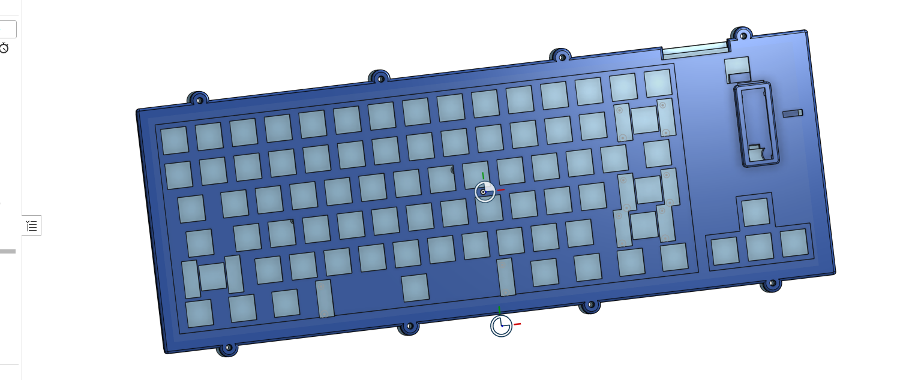
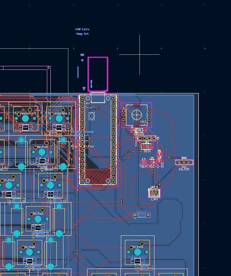
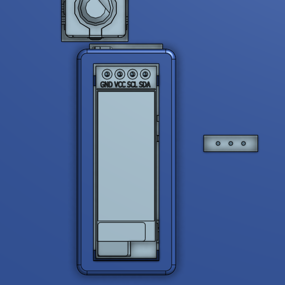

# KEEB
Its a custom keyboard! My current keyboard is pretty bad, and I thought why not make one, so i designed it. 

80-key Pico W keyboard with Bluetooth, a battery, USB charging/data, a volume encoder, OLED and USB-only RGB.







- [BOM and purchasing links](BOM.md) · [CSV](BOM.csv)
- [Case STEP with integrated switch plate](cad/KEEB-case.step)
- [Onshape source CAD and complete keyboard assembly](https://cad.onshape.com/documents/a273834a75c8cf83eaf3eccf/w/175ac2f63e3c24ffd6632dd1/e/d788e341cf0c23216b358283)
- [KiCad project](pcb/keeb_pcb.kicad_pro)
- [KiCanvas view](https://kicanvas.org/?repo=https%3A%2F%2Fgithub.com%2FCatsarepro21%2Fkeyboard%2Ftree%2Fmain%2Fpcb)
- [Gerbers and drill files](fabrication/KEEB-gerbers.zip)
- [Firmware source](firmware/) · [UF2](firmware/KEEB.uf2)

The case STEP contains the bottom, top with integrated switch plate, and battery cover. Print these three parts.


If Onshape shows 403 when opened from GitHub for some reason, copy and paste this address into your browser:

```text
https://cad.onshape.com/documents/a273834a75c8cf83eaf3eccf/w/175ac2f63e3c24ffd6632dd1/e/d788e341cf0c23216b358283
```

BOM: 
# Keyboard BOM


**Parts and PCB: $106.13.**

| Part | Specification | Needed | Buy | Line cost | Link |
|---|---|---:|---:|---:|---|
| Wireless controller | Raspberry Pi SC0918 Pico W | 1 | 1 | $6.00 | [Buy](https://www.adafruit.com/product/5526) |
| MX key switches | Gateron KS-3Y10B050NW-X1 | 80 | 80 | $16.00 | [Buy](https://mechanicalkeyboards.com/products/gateron-milky-yellow-50g-linear) |
| Matrix diodes | XCH 1N4148 / C7437620 | 81 | 100 | $0.91 | [Buy](https://www.lcsc.com/product-detail/C7437620.html) |
| RGB LEDs | OPSCO SK6812MINI-E / C5149201 | 79 | 85 | $5.53 | [Buy](https://www.lcsc.com/product-detail/C5149201.html) |
| Rotary encoder with push | Alps EC11E18244AU | 1 | 1 | $2.22 | [Buy](https://www.lcsc.com/product-detail/C202365.html) |
| Battery charger | MCP73831T-2ACI/OT | 1 | 1 | $0.78 | [Buy](https://www.lcsc.com/product-detail/C424093.html) |
| Battery isolation diode | Vishay SS14-E3/61T | 1 | 3 | $0.35 | [Buy](https://www.lcsc.com/product-detail/C47460.html) |
| Power slide switch | Wurth 450301014042, 300 mA / 24 V DC | 1 | 1 | $2.15 | [Buy](https://www.digikey.com/en/products/detail/w%C3%BCrth-elektronik/450301014042/5209104) |
| Battery connector | JST B2B-PH-K-S(LF)(SN) | 1 | 20 | $0.71 | [Buy](https://www.lcsc.com/product-detail/C131337.html) |
| Charge-current resistor | Yageo RC0805FR-0710KL (10k, 0805) | 1 | 100 | $0.58 | [Buy](https://www.lcsc.com/product-detail/C84376.html) |
| Charger capacitors | TDK C2012X5R1V106MT000E / C415295 (10uF, 0805) | 2 | 2 | $0.52 | [Buy](https://www.lcsc.com/product-detail/C415295.html) |
| RGB data translator | TI SN74LVC1T45DBVR | 1 | 5 | $0.42 | [Buy](https://www.lcsc.com/product-detail/C7843.html) |
| RGB current limiter | TI TPS2553DBVR | 1 | 1 | $0.54 | [Buy](https://www.lcsc.com/product-detail/C55266.html) |
| Control/status expander | TI PCA9536DR | 1 | 1 | $1.56 | [Buy](https://www.digikey.com/en/products/detail/texas-instruments/PCA9536DR/1573050) |
| Charger load switch | TI TPS22918DBVR | 1 | 1 | $0.59 | [Buy](https://www.digikey.com/en/products/detail/texas-instruments/TPS22918DBVR/5994601) |
| USB detection MOSFET | onsemi BSS138LT1G | 1 | 10 | $0.44 | [Buy](https://www.lcsc.com/product-detail/C82045.html) |
| Local bypass capacitors | Samsung CL10B104KB8NNNC (100nF, 0603) | 82 | 100 | $0.82 | [Buy](https://www.lcsc.com/product-detail/C1591.html) |
| USB switch input capacitors | Samsung CL21B105KAFNNNE (1uF, 0805) | 2 | 10 | $0.41 | [Buy](https://www.lcsc.com/product-detail/C116352.html) |
| RGB bulk capacitor | Samsung CL31A226KAHNNNE (22uF, 1206) | 1 | 1 | $0.48 | [Buy](https://www.digikey.com/en/products/detail/samsung-electro-mechanics/CL31A226KAHNNNE/3888705) |
| Charger rise-time capacitor | Murata GRM1885C1H103JA01D (10nF, 0603) | 1 | 1 | $0.14 | [Buy](https://www.digikey.com/en/products/detail/murata-electronics/GRM1885C1H103JA01D/4934772) |
| 330 ohm LED data series | Yageo RC0603FR-07330RL (330, 0603) | 1 | 10 | $0.25 | [Buy](https://www.digikey.com/en/products/detail/yageo/RC0603FR-07330RL/727162) |
| 100 kohm RGB pull-downs | Yageo RC0603FR-07100KL (100k, 0603) | 2 | 10 | $0.25 | [Buy](https://www.digikey.com/en/products/detail/yageo/RC0603FR-07100KL/729836) |
| 2.2 kohm enables and VBUS bleed | Yageo RC0603FR-072K2L (2.2k, 0603) | 3 | 100 | $0.18 | [Buy](https://www.lcsc.com/product-detail/C114662.html) |
| 4.7 kohm I2C pull-ups to 3.3 V | Yageo RC0603FR-074K7L (4.7k, 0603) | 2 | 10 | $0.25 | [Buy](https://www.digikey.com/en/products/detail/yageo/RC0603FR-074K7L/727212) |
| 10 kohm status pull-ups | Yageo RC0603FR-0710KL (10k, 0603) | 2 | 100 | $0.34 | [Buy](https://www.lcsc.com/product-detail/C98220.html) |
| 160 kohm RGB current limit | Yageo RC0603FR-07160KL (160k, 0603) | 1 | 100 | $0.22 | [Buy](https://www.lcsc.com/product-detail/C137793.html) |
| OLED board-side connection | Included cable: trim plug and direct-solder four wires by signal; no header | 1 | 1 | $0.00 | [Buy](https://www.waveshare.com/product/ai/0.91inch-oled-module.htm) |
| Stabilizer kit | Fynmi black PCB screw-in kit, 4 x 2u + 1 x 6.25u; mounting fit pending | 5 | 1 | $4.09 | [Buy](https://www.aliexpress.us/item/3256810601892072.html) |
| Protected LiPo battery | Adafruit 1578, 500 mAh | 1 | 1 | $7.95 | [Buy](https://www.adafruit.com/product/1578) |
| OLED module | Waveshare 14657, SSD1306 128 x 32 | 1 | 1 | $6.99 | [Buy](https://www.waveshare.com/product/ai/0.91inch-oled-module.htm) |
| Encoder knob | Adafruit 5093 | 1 | 1 | $0.75 | [Buy](https://www.adafruit.com/product/5093) |
| USB data cable | Cvilux DH-20M50055 | 1 | 1 | $1.58 | [Buy](https://www.digikey.com/en/products/detail/cvilux-usa/DH-20M50055/13175849) |
| Keycap set | 129-key white pudding PBT, OEM profile, MX stems; required key sizes covered | 80 | 1 | $10.22 | [Buy](https://www.aliexpress.us/item/3256809062215921.html) |
| Case inserts | XHHD SZTB1150 / C51939019, M3 x 4.5 x 5 mm | 10 | 20 | $0.47 | [Buy](https://www.lcsc.com/product-detail/C51939019.html) |
| Case screws | M3 50pcs / 8mm ISO7380 button-head | 10 | 50 | $1.75 | [Buy](https://www.aliexpress.us/item/3256801950414714.html) |
| Adhesive feet | Adafruit 550, pack of four approx 8 × 4 mm bumpers | 4 | 1 | $0.95 | [Buy](https://www.adafruit.com/product/550) |
| Case print | Printed bottom, top with integrated MX switch plate, removable battery cover | 3 | 1 | Printing Legion? | [Buy](https://printlegion.hackclub.com/) |
| Controller mounting pins | BOOMELE 2.54-1*40P / C2337 | 1 | 5 | $0.80 | [Buy](https://www.lcsc.com/product-detail/C2337.html) |
| Battery retention/insulation | JSZ-007 polyimide tape, 30 mm x 33 m x 0.05 mm | 1 | 1 | $2.34 | [Buy](https://www.lcsc.com/product-detail/C6798411.html) |
| PCB | 359.95 x 124.25 mm; 2 layers; 1.6 mm FR4; green; HASL; no optional paid production-file confirmation | 1 | 5 | $25.60 | [Buy](https://jlcpcb.com/quote) |
| AliExpress shipping | White keycaps and Fynmi stabilizers together; cart showed free shipping on 13 October 2026 | 1 | 1 | $0.00 | [Buy](https://www.aliexpress.us/p/shoppingcart/index.html) |

What I learned

Helped a lot with large PCB design, wiring carefully, and just overall laying things out well.
