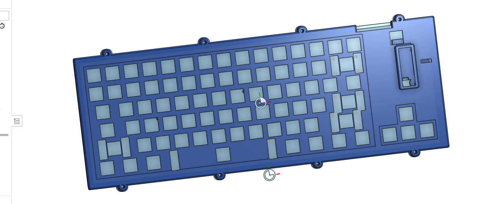
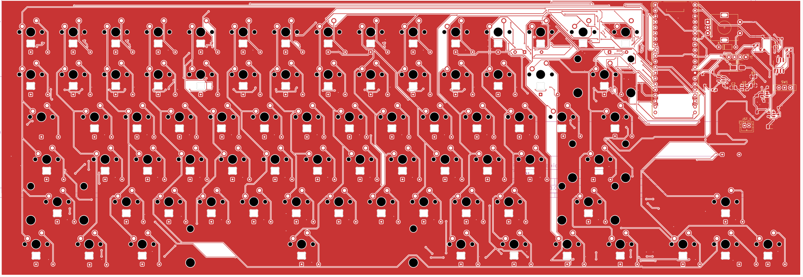
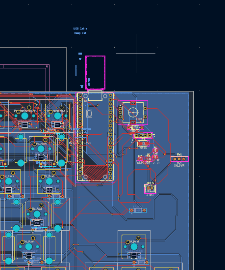
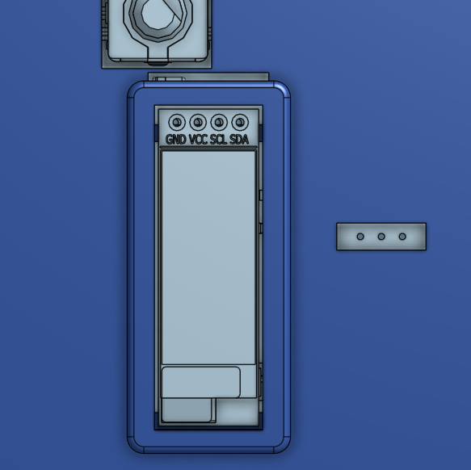
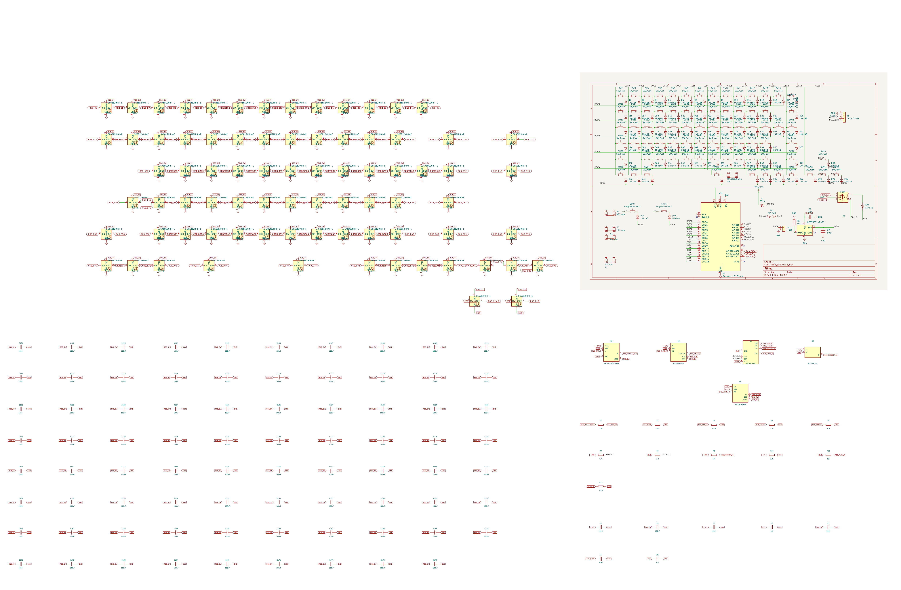

# KEEB

Its a custom keyboard! My current keyboard is pretty bad, and I thought why not make one, so i designed it.

KEEB is an 80-key keyboard built around a Pico W, with USB and Bluetooth, a rechargeable battery, a volume encoder, and an OLED. It has a custom PCB and a 3D printed case with the switch plate built into the top. RGB only works when plugged into USB, which I think is fine.

## Pictures

Renders (Blender + Onshape):


The case and integrated switch plate:



The full PCB layout:



A closer look at the routing around the Pico W and controls:



The OLED and encoder area:



The schematic (open the image to zoom in):



## Project files

- [BOM and purchasing links](BOM.md) · [CSV](BOM.csv)
- [Case STEP with integrated switch plate](cad/KEEB-case.step)
- [Onshape source CAD and complete keyboard assembly](https://cad.onshape.com/documents/a273834a75c8cf83eaf3eccf/w/175ac2f63e3c24ffd6632dd1/e/d788e341cf0c23216b358283)
- [KiCad project](pcb/keeb_pcb.kicad_pro)
- [KiCanvas view](https://kicanvas.org/?repo=https%3A%2F%2Fgithub.com%2FCatsarepro21%2Fkeyboard%2Ftree%2Fmain%2Fpcb)
- [Gerbers and drill files](fabrication/KEEB-gerbers.zip)
- [Firmware source](firmware/) · [UF2](firmware/KEEB.uf2)

If Onshape shows 403 when opened from GitHub for some reason, copy and paste this address into your browser:

```text
https://cad.onshape.com/documents/a273834a75c8cf83eaf3eccf/w/175ac2f63e3c24ffd6632dd1/e/d788e341cf0c23216b358283
```

## Wiring

The switches, diodes, encoder, and RGB are connected through the PCB. The OLED uses its included cable, with the board-side plug trimmed off and the four wires soldered directly to J1. Match the signal labels, since wire colors and connector order can vary.

```text
PCB J1                         OLED
1  GND ----------------------- GND
2  +3V3 ---------------------- VCC
3  OLED_SCL (Pico GP21) ------- SCL / CLK
4  OLED_SDA (Pico GP22) ------- SDA / DIN

Protected 500 mAh LiPo -------- JST_1 battery connector
                               Check + and - before plugging it in.
```

The OLED is the Waveshare 0.91 inch SSD1306 module, using I2C at address 0x3c. Use the PCB pad numbers above, not the order the wires happen to come in.

## How to assemble

1. Order the PCB using the Gerbers, and get the parts in the BOM below. The board is 359.95 x 124.25 mm, 2 layers, and 1.6 mm thick.
2. Import the case STEP into your slicer/CAD tool and export the three separate parts for printing: the bottom, top with integrated switch plate, and battery cover. Check the switch and stabilizer fit before committing to the full assembly.
3. Install the M3 heat-set inserts in the printed mounting holes. Let them cool before fitting the screws.
4. With USB and the battery disconnected, solder the small PCB components first: resistors, capacitors, diodes, power circuitry, and RGB LEDs. Follow the component references and orientations in KiCad, especially diode polarity, LED orientation, and IC pin 1.
5. Solder the battery connector, power switch, encoder, and Pico W mounting pins. Fit the Pico W in the orientation shown on the PCB, with its USB port lined up with the case opening.
6. Fit the PCB screw-in stabilizers before installing the switches. Clip the switches into the top's integrated plate, line their pins up with the PCB, and solder them. Check for bent pins as you go.
7. Wire the OLED as shown above and position it behind the case opening. Keep the cable clear of the switches and screw holes.
8. Check the solder joints for bridges and check for a short between power and ground. Leave the battery disconnected for the first USB test, then flash the firmware using the steps below.
9. Test every key, the encoder, and the OLED before closing the case. The current firmware sets the LEDs to dim blue when USB is configured.
10. Disconnect USB, check the battery connector polarity, and connect the protected LiPo. Secure and insulate it with the polyimide tape, keeping it clear of sharp pins and screws. Test battery power and Bluetooth before closing it up.
11. Fit the assembly into the bottom, route the OLED wires so they aren't pinched, and fasten the case and battery cover with the M3 screws. Add the keycaps, encoder knob, and four feet.

## How to flash

Use the included firmware for the original Pico W (RP2040).

1. Download [KEEB.uf2](firmware/KEEB.uf2) using GitHub's download button, or use the file from a downloaded copy of this repo.
2. Disconnect the battery and unplug USB.
3. Hold the Pico W's BOOTSEL button while connecting it to your computer with a USB data cable, then release the button.
4. A drive called `RPI-RP2` should show up. Copy `KEEB.uf2` onto it.
5. The Pico should restart and the drive should disappear. Check that the keyboard is detected, then try the keys in a text editor.

The firmware uses RMK, with the keymap in [keyboard.toml](firmware/keyboard.toml). The encoder is mapped to volume up/down, and its push switch is mapped to mute. Vial support is enabled for changing mappings over USB.

For Bluetooth, disconnect USB, connect the battery, turn on the power switch, and look for `KEEB Wireless` in your computer's Bluetooth pairing menu.

The OLED code displays `KEEB` and `USB` or `BAT`. `BAT` means battery mode, not a battery percentage. RGB and charging are enabled by the current firmware after the USB connection is configured.

## What I learned

Helped a lot with large PCB design, wiring carefully, and just overall laying things out well. Adding Bluetooth also meant adding a battery and charger, rerouting around the antenna area, and changing the case to fit everything.

## BOM

Original listed parts and PCB total: **$106.13**, with printing still to be priced. Check current prices and shipping before ordering.

| Part | Specification | Needed | Buy | Line cost | Link |
|---|---|---:|---:|---:|---|
| Wireless controller | Raspberry Pi SC0918 Pico W | 1 | 1 | $6.00 | [Buy](https://www.adafruit.com/product/5526) |
| MX key switches | Gateron KS-3Y10B050NW-X1 | 80 | 80 | $16.00 | [Buy](https://mechanicalkeyboards.com/products/gateron-milky-yellow-50g-linear) |
| Matrix diodes | XCH 1N4148 / C7437620 | 81 | 100 | $0.91 | [Buy](https://www.lcsc.com/product-detail/C7437620.html) |
| RGB LEDs | OPSCO SK6812MINI-E / C5149201 | 79 | 85 | $5.53 | [Buy](https://www.lcsc.com/product-detail/C5149201.html) |
| Rotary encoder with push | Alps EC11E18244AU | 1 | 1 | $2.22 | [Buy](https://www.lcsc.com/product-detail/C202365.html) |
| Battery charger | MCP73831T-2ACI/OT | 1 | 1 | $0.78 | [Buy](https://www.lcsc.com/product-detail/C424093.html) |
| Battery isolation diode | Vishay SS14-E3/61T | 1 | 3 | $0.35 | [Buy](https://www.lcsc.com/product-detail/C47460.html) |
| Power slide switch | Wurth 450301014042, 300 mA / 24 V DC | 1 | 1 | $2.15 | [Buy](https://www.digikey.com/en/products/detail/w%C3%BCrth-elektronik/450301014042/5209104) |
| Battery connector | JST B2B-PH-K-S(LF)(SN) | 1 | 20 | $0.71 | [Buy](https://www.lcsc.com/product-detail/C131337.html) |
| Charge-current resistor | Yageo RC0805FR-0710KL (10k, 0805) | 1 | 100 | $0.58 | [Buy](https://www.lcsc.com/product-detail/C84376.html) |
| Charger capacitors | TDK C2012X5R1V106MT000E / C415295 (10uF, 0805) | 2 | 2 | $0.52 | [Buy](https://www.lcsc.com/product-detail/C415295.html) |
| RGB data translator | TI SN74LVC1T45DBVR | 1 | 5 | $0.42 | [Buy](https://www.lcsc.com/product-detail/C7843.html) |
| RGB current limiter | TI TPS2553DBVR | 1 | 1 | $0.54 | [Buy](https://www.lcsc.com/product-detail/C55266.html) |
| Control/status expander | TI PCA9536DR | 1 | 1 | $1.56 | [Buy](https://www.digikey.com/en/products/detail/texas-instruments/PCA9536DR/1573050) |
| Charger load switch | TI TPS22918DBVR | 1 | 1 | $0.59 | [Buy](https://www.digikey.com/en/products/detail/texas-instruments/TPS22918DBVR/5994601) |
| USB detection MOSFET | onsemi BSS138LT1G | 1 | 10 | $0.44 | [Buy](https://www.lcsc.com/product-detail/C82045.html) |
| Local bypass capacitors | Samsung CL10B104KB8NNNC (100nF, 0603) | 82 | 100 | $0.82 | [Buy](https://www.lcsc.com/product-detail/C1591.html) |
| USB switch input capacitors | Samsung CL21B105KAFNNNE (1uF, 0805) | 2 | 10 | $0.41 | [Buy](https://www.lcsc.com/product-detail/C116352.html) |
| RGB bulk capacitor | Samsung CL31A226KAHNNNE (22uF, 1206) | 1 | 1 | $0.48 | [Buy](https://www.digikey.com/en/products/detail/samsung-electro-mechanics/CL31A226KAHNNNE/3888705) |
| Charger rise-time capacitor | Murata GRM1885C1H103JA01D (10nF, 0603) | 1 | 1 | $0.14 | [Buy](https://www.digikey.com/en/products/detail/murata-electronics/GRM1885C1H103JA01D/4934772) |
| 330 ohm LED data series | Yageo RC0603FR-07330RL (330, 0603) | 1 | 10 | $0.25 | [Buy](https://www.digikey.com/en/products/detail/yageo/RC0603FR-07330RL/727162) |
| 100 kohm RGB pull-downs | Yageo RC0603FR-07100KL (100k, 0603) | 2 | 10 | $0.25 | [Buy](https://www.digikey.com/en/products/detail/yageo/RC0603FR-07100KL/729836) |
| 2.2 kohm enables and VBUS bleed | Yageo RC0603FR-072K2L (2.2k, 0603) | 3 | 100 | $0.18 | [Buy](https://www.lcsc.com/product-detail/C114662.html) |
| 4.7 kohm I2C pull-ups to 3.3 V | Yageo RC0603FR-074K7L (4.7k, 0603) | 2 | 10 | $0.25 | [Buy](https://www.digikey.com/en/products/detail/yageo/RC0603FR-074K7L/727212) |
| 10 kohm status pull-ups | Yageo RC0603FR-0710KL (10k, 0603) | 2 | 100 | $0.34 | [Buy](https://www.lcsc.com/product-detail/C98220.html) |
| 160 kohm RGB current limit | Yageo RC0603FR-07160KL (160k, 0603) | 1 | 100 | $0.22 | [Buy](https://www.lcsc.com/product-detail/C137793.html) |
| OLED board-side connection | Included cable: trim plug and direct-solder four wires by signal; no header | 1 | 1 | $0.00 | [Buy](https://www.waveshare.com/product/ai/0.91inch-oled-module.htm) |
| Stabilizer kit | Fynmi black PCB screw-in kit, 4 x 2u + 1 x 6.25u | 5 | 1 | $4.09 | [Buy](https://www.aliexpress.us/item/3256810601892072.html) |
| Protected LiPo battery | Adafruit 1578, 500 mAh | 1 | 1 | $7.95 | [Buy](https://www.adafruit.com/product/1578) |
| OLED module | Waveshare 14657, SSD1306 128 x 32 | 1 | 1 | $6.99 | [Buy](https://www.waveshare.com/product/ai/0.91inch-oled-module.htm) |
| Encoder knob | Adafruit 5093 | 1 | 1 | $0.75 | [Buy](https://www.adafruit.com/product/5093) |
| USB data cable | Cvilux DH-20M50055 | 1 | 1 | $1.58 | [Buy](https://www.digikey.com/en/products/detail/cvilux-usa/DH-20M50055/13175849) |
| Keycap set | 129-key white pudding PBT, OEM profile, MX stems; required key sizes covered | 80 | 1 | $10.22 | [Buy](https://www.aliexpress.us/item/3256809062215921.html) |
| Case inserts | XHHD SZTB1150 / C51939019, M3 x 4.5 x 5 mm | 10 | 20 | $0.47 | [Buy](https://www.lcsc.com/product-detail/C51939019.html) |
| Case screws | M3 50pcs / 8mm ISO7380 button-head | 10 | 50 | $1.75 | [Buy](https://www.aliexpress.us/item/3256801950414714.html) |
| Adhesive feet | Adafruit 550, pack of four approx 8 × 4 mm bumpers | 4 | 1 | $0.95 | [Buy](https://www.adafruit.com/product/550) |
| Case print | Printed bottom, top with integrated MX switch plate, removable battery cover | 3 | 1 | Printing Legion? | [Buy](https://printlegion.hackclub.com/) |
| Controller mounting pins | BOOMELE 2.54-1*40P / C2337 | 1 | 5 | $0.80 | [Buy](https://www.lcsc.com/product-detail/C2337.html) |
| Battery retention/insulation | JSZ-007 polyimide tape, 30 mm x 33 m x 0.05 mm | 1 | 1 | $2.34 | [Buy](https://www.lcsc.com/product-detail/C6798411.html) |
| PCB | 359.95 x 124.25 mm; 2 layers; 1.6 mm FR4; green; HASL; no optional paid production-file confirmation | 1 | 5 | $25.60 | [Buy](https://jlcpcb.com/quote) |
| AliExpress shipping | White keycaps and Fynmi stabilizers together; cart showed free shipping on 13 October 2026 | 1 | 1 | $0.00 | [Buy](https://www.aliexpress.us/p/shoppingcart/index.html) |
